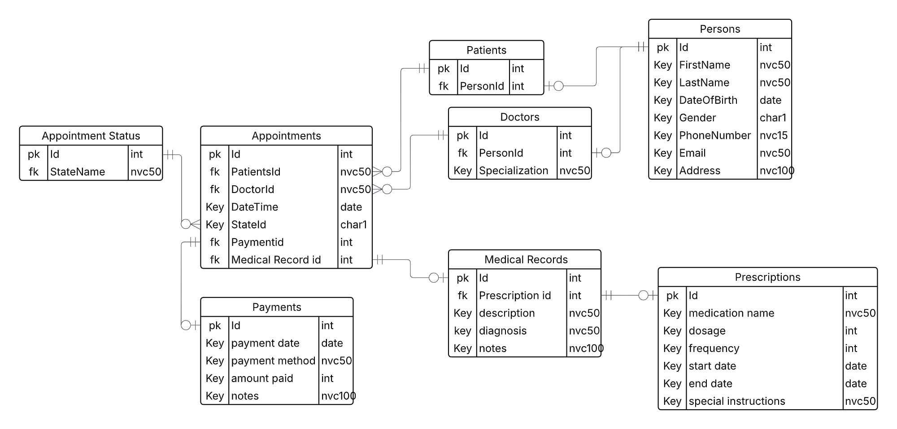
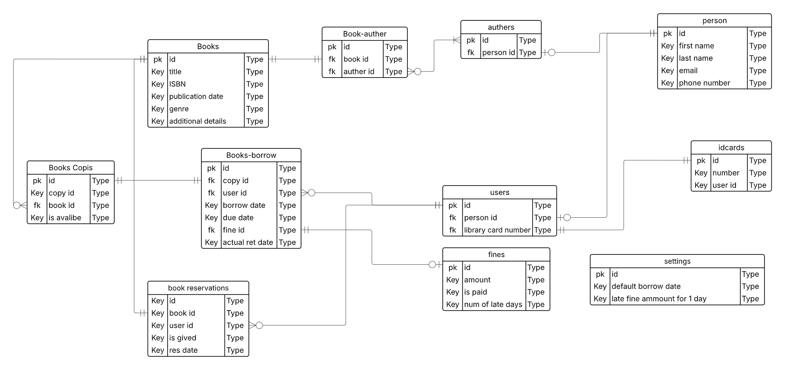
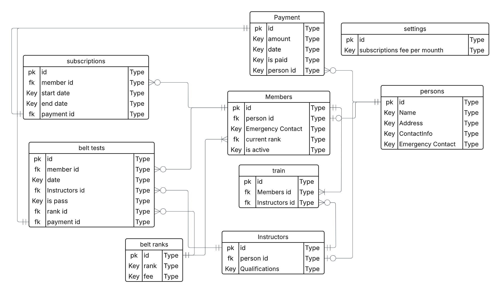
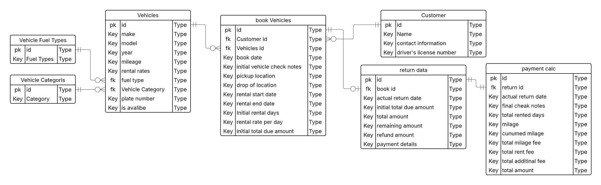
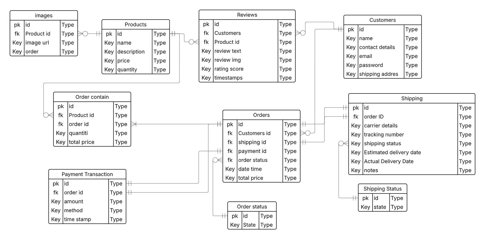

# Database Design Projects

Five database design exercises, each delivered as a requirements specification (PDF) with a full relational schema: tables, primary/foreign keys, column types, and relationships.

## Projects

| #   | Project        | Domain         | Key entities                                              |
| --- | -------------- | -------------- | --------------------------------------------------------- |
| 1   | Simple Clinic  | Healthcare     | Persons, Patients, Doctors, Appointments, Payments        |
| 2   | Simple Library | Library        | Persons, Authors, Books, Book Copies, Borrowing, ID cards |
| 3   | Karate Club    | Sports club    | Members, Subscriptions, Payments, Belt Tests, Training    |
| 4   | Car Rental     | Rental service | Vehicles, Categories, Fuel Types, Customers, Bookings     |
| 5   | Online Store   | E-commerce     | Customers, Products, Product Images, Orders, Reviews      |

## What each spec covers

- **Entities & attributes** — every table with its columns, data types (`int`, `date`, `nvarchar`, `char`, …), and constraints
- **Primary & foreign keys** — identifiers and relationships between tables
- **Relationship design** — junction/child tables where needed (book–author, book copies, booking records, order lines, reviews)

Example (Project 4 — Car Rental): `Vehicles` (make, model, year, mileage, rates, plate) links to `Vehicle Categories` and `Vehicle Fuel Types`, while `book Vehicles` connects `Customers` to vehicles with pickup/drop-off details and inspection notes.

## Skills demonstrated

- Requirements analysis and entity identification
- Normalization and referential integrity
- Relational modeling with PK/FK constraints
- Communicating schema design through documentation

## Tech stack

- Relational database design (SQL Server–style type system)
- Delivered as PDF requirements specifications

  
  
  
  
  
